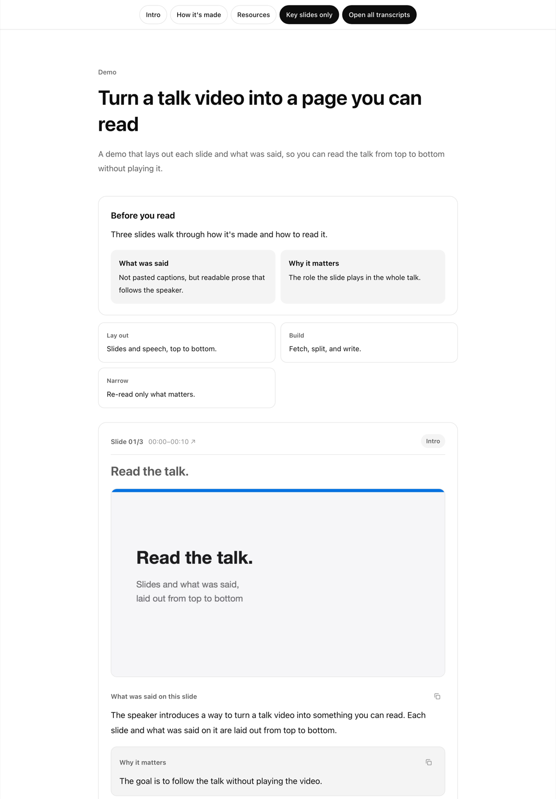

# kamishibai

English | [日本語](README.md)

A [Claude Code](https://claude.com/claude-code) skill that turns talk videos such as WWDC and Tech Talks into an HTML page you can read top to bottom without playing them. Each slide comes with its image, what was said, why it matters, and a timestamped transcript.



## Install

```bash
git clone https://github.com/snoozelag/kamishibai ~/.claude/skills/kamishibai
```

Requires `ffmpeg` and Python 3.9+.

## Usage

```text
Make a kamishibai of this session in English: https://developer.apple.com/videos/play/wwdc2025/256/
```

For local videos, tell Claude where the video and subtitles (SRT) are. See [SKILL.md](SKILL.md) (Japanese) for the full workflow.

## Note

The generated HTML contains frames and captions from the source video. Keep it for personal reading.

## License

[MIT](LICENSE)
