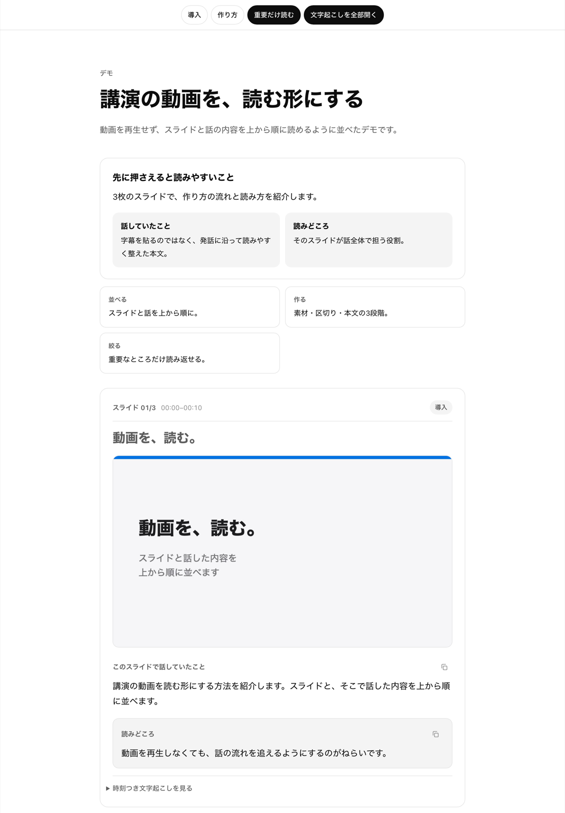

# kamishibai

[English](README.en.md) | 日本語

WWDC・Tech Talks などの講演動画を HTML にして、再生せずに上から読めるようにする [Claude Code](https://claude.com/claude-code) のスキルです。スライドごとに、画像・話していたこと・読みどころ・時刻つきの文字起こしを並べます。



## インストール

```bash
git clone https://github.com/snoozelag/kamishibai ~/.claude/skills/kamishibai
```

`ffmpeg` と Python 3.9 以上が必要です。

## 使い方

```text
このセッションを紙芝居にして https://developer.apple.com/videos/play/wwdc2025/256/
```

手元の動画を使うときは、動画と字幕（SRT）の場所を伝えます。詳しい手順は [SKILL.md](SKILL.md) にあります。

## 注意

生成した HTML には元の動画の画面と字幕が入ります。個人で読む用途にとどめてください。

## ライセンス

[MIT](LICENSE)
